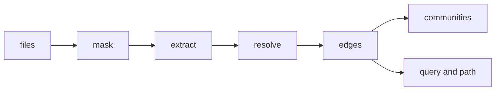
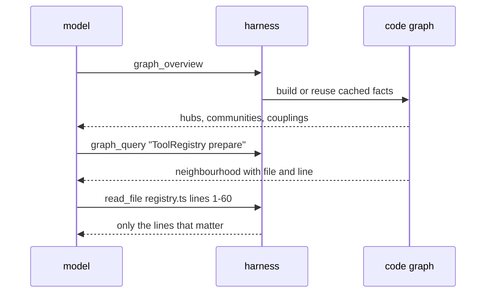

# how a coding agent sees a codebase as a graph

suppose you ask a coding agent: "what happens when `prepare` is called?"

a normal agent starts by searching for the word `prepare`. it gets a list of files. it opens one, finds a call to another function, opens that file too, and keeps going. after a few steps it has read a lot of code, and most of it had nothing to do with the question.

every file it opens costs tokens. tokens cost money, and they also fill the model’s context window, which makes it slower and easier to confuse.

the coding agent i’m building has another option. before it reads any file, it can ask a map of the code. the map says: here are the functions that call `prepare`, here is what `prepare` calls, and here are the exact file and line for each. then the agent opens only those few places.

this post explains how that map is built, in plain terms, with small examples you can follow. all the examples and numbers below come from running the real code.

## the idea in one picture

a codebase is full of things that point at other things. a function calls another function. a file imports another file. a class extends another class. if you write each of those down as a line between two dots, you get a graph.

- the dots are called **nodes**: files, classes, interfaces, types, functions, methods and constants
- the lines are called **edges**: `contains`, `imports`, `calls`, `uses`, `extends` and `implements`

the graph is built in a few steps:



1. **mask**: blank out comments and the insides of strings
2. **extract**: find the definitions, calls and imports in each file
3. **resolve**: decide which definition each call really points to
4. **edges**: store the result, and mark how sure we are
5. **communities and queries**: group the files, and let the agent ask questions

it does not call a language model, it does not run your code, and it writes nothing into your project. it only reads text.

## one small project, start to finish

here is a tiny project with three files. i’ll follow it through every step.

```ts
// src/types.ts
export interface ToolContext { root: string }
export interface Tool { run(ctx: ToolContext): void }
```

```ts
// src/registry.ts
import { ToolContext } from './types';

export class ToolRegistry {
  prepare(name: string, ctx: ToolContext) {
    // TODO: call runAgent here
    return this.validate(name);
  }
  validate(name: string) {
    return name.length > 0;
  }
}
```

```ts
// src/runner.ts
import { ToolRegistry } from './registry';

export function runAgent(registry: ToolRegistry) {
  registry.prepare('read', { root: '.' });
  helper();
}
function helper() {}
```

after the whole pipeline runs, the graph for this project has the three files plus a few extra, and the interesting edges look like this, exactly as the code prints them:

```
src/runner.ts   --imports-->  src/registry.ts
src/registry.ts --imports-->  src/types.ts
ToolRegistry    --contains--> ToolRegistry.prepare
ToolRegistry.prepare --calls-->  ToolRegistry.validate
ToolRegistry.prepare --uses-->   ToolContext
runAgent        --calls-->    helper
runAgent        --uses-->     ToolRegistry
runAgent        --calls-->    ToolRegistry.prepare   INFERRED 0.7
```

notice the last line. it is the only edge marked `INFERRED`. we will get to why a bit later. first, how did we get here?

## step 1: masking

the extractor reads source files as plain text. plain text has a problem: it is full of words that look like code but are not.

look at this line in `registry.ts`:

```ts
// TODO: call runAgent here
```

the words `call runAgent` appear in a comment. if the extractor is not careful, it will think `prepare` calls `runAgent`, and the graph will be wrong.

the fix is **masking**. before looking for anything, the extractor replaces every comment with spaces. it also replaces the text inside strings with spaces, and keeps the quote marks. for example:

```ts
const label = "class Foo";   // not a real class
```

becomes

```ts
const label = "         ";
```

the important detail is that every character becomes a space, and only newlines are kept. so every remaining piece of code is still at exactly the same position and on exactly the same line as before. that is what lets the graph later say "this function is at line 4" and be correct.

the same idea works for python, where comments start with `#` and docstrings use triple quotes.

## step 2: extraction

now the extractor walks through the masked file and collects four lists.

**symbols** are the definitions. the extractor recognises them by the shape of the line. a line that starts at the left edge with `export function name` is a function. `class Name` is a class. inside a class, an indented line like `prepare(name: string) {` is a method.

it also needs to know where each symbol ends, so it knows which lines belong to it. for typescript it counts curly braces until they balance. for python it uses indentation, and a block ends when the indentation goes back to the level of the definition.

for `registry.ts` it finds three symbols:

```
ToolRegistry   class    lines 3 to 11
prepare        method   lines 4 to 7    (inside ToolRegistry)
validate       method   lines 8 to 10   (inside ToolRegistry)
```

**references** are the places where a symbol uses a name. for every line inside a symbol, the extractor looks at each word and asks three questions: is it followed by `(`, so it is a call? is it written after a dot, so it is a member? and if so, what is on the left of the dot?

for `registry.ts` it finds:

```
inside prepare:  ToolContext   (just mentioned, not called)
inside prepare:  validate      (a call, on the receiver "this")
```

the `// TODO: call runAgent here` line produced nothing, because of masking.

**imports** record what each file brings in. `import { ToolContext } from './types'` becomes: from `./types`, the name `ToolContext`. it also understands renames (`as`), default imports, `import * as ns`, `require(...)`, and re-exports such as `export { X } from './y'`.

**inheritance** records `extends` and `implements` clauses.

at this point nothing is connected yet. each file only knows its own facts, as names. connecting them is the next step.

## step 3: resolving names into edges

the facts say "inside `runAgent` there is a call to `helper`". but which `helper`? there could be many in a big project. the resolver follows a clear order.

**rule 1: look in the same file.** `runAgent` calls `helper`, and `runner.ts` defines `helper`. done. that is the `runAgent --calls--> helper` edge.

**rule 2: follow the imports.** `runner.ts` imports `ToolRegistry` from `./registry`. so a mention of `ToolRegistry` points to the class in that file. that is the `runAgent --uses--> ToolRegistry` edge.

there is some work here. an import path like `./registry.js` often points to a `.ts` file on disk, so the resolver tries the right extensions, and also folders with an `index` file. python has its own rules for relative imports like `from .models import User`.

**rule 3: follow re-exports.** some projects have a file whose only job is to forward names:

```ts
// src/index.ts
export { UserStore } from './user';
```

```ts
// src/main.ts
import { UserStore } from './index';
export function boot() { return new UserStore(); }
```

`main.ts` imports from `index.ts`, but `UserStore` is not defined there. the resolver notices that `index.ts` re-exports it from `./user`, follows that link, and finds the real class. the result is `boot --calls--> UserStore` pointing at the right file. it will follow a chain like this up to three hops.

**rule 4: `this` and inheritance.** when a method calls `this.save(name)`, the resolver looks for `save` on the same class. if it is not there, it walks up the `extends` chain, up to four levels:

```ts
class Store { save(data) { return data; } }
class UserStore extends Store {
  add(name) { return this.save(name); }
}
```

`save` is not defined in `UserStore`, but `UserStore extends Store`, so the edge becomes `UserStore.add --calls--> Store.save`. in the example project the same rule gave us `ToolRegistry.prepare --calls--> ToolRegistry.validate`.

**rule 5: namespaces.** with `import * as tools from './tools'`, a call like `tools.run()` is looked up in the exports of that file.

python goes through the same logic. in a small test, `from .models import User` followed by `User()` produced `main --calls--> User`, and `self.name()` inside a method produced `User.greet --calls--> User.name`.

every edge made by these rules says something that is written in the source and has only one possible meaning. these edges are tagged **EXTRACTED**.

## when the graph has to guess

now back to the `INFERRED 0.7` edge:

```ts
export function runAgent(registry: ToolRegistry) {
  registry.prepare('read', { root: '.' });
}
```

to know that `registry.prepare` is `ToolRegistry.prepare`, you need to know the type of `registry`. a human reads `registry: ToolRegistry` and knows at once. but the extractor only does text matching. it has no type checker, so it does not know what `registry` is.

so it does something sensible. it asks: how many methods named `prepare` exist in the project? exactly one. that is a good hint, so it adds an edge, but it marks it `INFERRED` and gives a score between 0 and 1:

- 0.7 if the method is in the same file or a file that is already imported (that was our case)
- 0.4 if it is somewhere else
- 0.6 if several methods share the name but only one of them is in a nearby file

here is a second example where the guess is less certain. two classes have a method called `render`:

```ts
// chat.ts
export class ChatView { render(items) { /* ... */ } }
// diff.ts
export class DiffView { render(patch) { /* ... */ } }
// app.ts
import { ChatView } from './chat';
export function show(view, items) { view.render(items); }
```

the extractor cannot know whether `view` is a `ChatView` or a `DiffView`. it picks `ChatView.render` with score 0.6, because `app.ts` imports `chat.ts` and not `diff.ts`. that is a reasonable guess, and it might be wrong. the score and the tag say so honestly.

two small filters stop the graph from filling with noise. names that exist everywhere, like `map`, `get`, `push`, `then` and `parse`, never produce guessed edges. neither do names shorter than four letters. a guessed edge to `get` would point at a hundred things and mean nothing.

the tag is kept all the way to the model. when the agent reads a result it can see which links come from the source and which are guesses, and its instructions say to open the file and check the guessed ones.

## finding the shape of the project: communities

a big project has regions. there is the part that runs the agent, the part that defines tools, the part that draws the screen. nobody writes this down in a file, but the edges show it. files in the same region call each other a lot, and talk to other regions much less.

the graph finds these regions with an algorithm called **weighted label propagation**. the idea is simple, like rumours spreading in a school.

1. every file starts with its own label, like its own name tag
2. files take turns looking at the files they are connected to
3. a file adds up how much connection weight each label has around it, and switches to the strongest label if that beats its current one
4. repeat until nobody changes

weights depend on how strong the relationship is. `extends` counts 1.5. `imports`, `calls` and `implements` count 1. `uses` counts 0.5. a guessed edge counts its score, so a 0.4 guess weighs less than a sure link.

here is a tiny example of one step. file C is connected to A with an `extends` (1.5) and to B with an `imports` (1), and to D with a `uses` (0.5). A and B both have label X, and D has label Y.

```
label X:  1.5 + 1   = 2.5
label Y:  0.5       = 0.5
```

C adopts label X. in this way labels flow through tight groups and stop at thin boundaries.

try it on a toy graph of twelve files. press play, or step through one file at a time. the weights and the update rule are the real ones.

```demo
label-propagation
```

two details make this work well in practice. a file only switches when the new label is strictly stronger, so ties can never make it flip back and forth. and sometimes a very tightly linked project collapses into one huge blob. when one group holds more than 60 percent of the files, the graph splits it by folder.

each community also gets a **cohesion** score: the share of its connection weight that stays inside the group. a group with low cohesion mostly talks to other groups, which can mean it is in the wrong place.

on the agent’s own repository, the overview found groups you would draw on a whiteboard:

```
[0] src/electron/agent (runAgent):        17 files, cohesion 0.69
[1] src/electron/agent/tools (AgentTool):  6 files, cohesion 0.57
[2] src/renderer (App):                    6 files, cohesion 0.63
[4] src/electron/graph (buildCodeGraph):   4 files, cohesion 0.84
```

the graph code itself came out as the tightest group, at 0.84.

## asking the graph questions

the agent gets three tools.

**`graph_overview`** is the first call in a new project. it returns the most connected symbols (the hubs), the communities, and the cross-group links that are most likely to be surprising. on the agent’s own repository the top hubs were `App`, `AgentTool`, `runAgent` and `KeyProvider`, which matches how the app is actually built.

**`graph_query`** takes a symbol name or a short question. it works in two stages.

first it finds starting points. every node is scored against the words in the question. an exact identifier match scores highest (12), then an exact name (10), then a matching word inside a camelCase name (6), then a partial match (4), then a match in the file path. the four best nodes become the starting points.

second it grows outward from them, like a ripple. it follows edges one step, then two, then three (the agent picks the depth, from 1 to 3). at each node it prefers sure links over guessed ones, and well-connected neighbours over dead ends, and it looks at no more than eight neighbours per node. it stops when it reaches the node limit.

here is the real answer for the question "prepare" on the small project from earlier:

```
Graph query "prepare" — 10 nodes, 6 relationships (depth 2).

Nodes (closest first):
- * ToolRegistry.prepare (method, src/registry.ts:4)
- ToolContext (interface, src/types.ts:1)
- ToolRegistry (class, src/registry.ts:3)
- ToolRegistry.validate (method, src/registry.ts:8)
- runAgent (function, src/runner.ts:3)
- ...

Relationships:
- ToolRegistry.prepare --uses--> ToolContext
- ToolRegistry.prepare --calls--> ToolRegistry.validate
- runAgent --calls--> ToolRegistry.prepare INFERRED 0.7
- runAgent --uses--> ToolRegistry
- runAgent --calls--> helper
```

in a few lines the agent knows who calls `prepare`, what `prepare` calls, and exactly where each one lives. drag the sliders below to see how depth and the node limit change the answer.

```demo
query-expansion
```

**`graph_path`** answers "how does A reach B?". it does a breadth-first search, so it finds the shortest chain of edges, with a limit of eight steps. in the small project:

```
Path from runAgent to ToolRegistry.validate (2 hops):
- runAgent --uses--> ToolRegistry
- ToolRegistry --contains--> ToolRegistry.validate
```

this is useful for questions like "how does a button click end up writing a file?".

here is how a typical session looks. the graph helps the agent decide where to read, and then the agent reads only that part.



every answer is cut to 12,000 characters at most, so one query can never flood the context.

the graph is only a map. the agent still reads the real code before it changes anything.

## keeping it fast

the graph is rebuilt from the files on disk every time a tool is called, so it can never be out of date. that is only practical because the work is cheap.

- the facts for each file are cached, keyed by a hash (sha1) of the file’s content. if a file did not change, it is not read through the extractor again
- a scan stops at 2,000 files or 15 seconds, and the answer says so if it was cut short
- the cache remembers up to three projects

there is one more detail about cost. every tool the model can use is described in the request, and that description is sent again on every turn. so a tool costs tokens even when it is never used. sub-agents are small helpers that look into one question each, so they get only `graph_query` and not all three tools.

## real numbers

i ran it on the agent’s own source code:

- files: 61
- symbols: 354
- relationships: 1,223 (1,172 extracted, 51 inferred)
- first build: about 1.3 seconds
- rebuild with warm cache: about 60 milliseconds
- all the source files together: about 97,000 tokens
- the overview: about 675 tokens
- a single query: about 900 to 1,150 tokens

the interesting rows are the last three. reading every file would cost about 97,000 tokens. the overview costs about 675, and a focused query costs around a thousand.

to be fair, this compares the size of an answer with the size of the source. it is not a full measurement of savings. after a query the agent still opens a few files, and i have not yet run a full task with and without the graph. i would rather tell you that than invent a percentage.

## where it gets things wrong

the extractor matches text patterns. it is not a compiler, so it fails in predictable ways. these are real cases.

**callbacks are invisible.** in this code, nothing links `later` to `render`:

```ts
export function later(chat: ChatView) {
  const fn = chat.render;
  fn(['a']);
}
```

the graph records that `later` uses `ChatView`, but the call `fn([...])` goes to a variable, and the extractor cannot follow values around.

**one-line classes are skipped.** methods are found by looking for indented lines inside a class. if the whole class is on one line, `class Mailer { send() {} }`, the methods are not found.

**guessed edges can be wrong.** the `view.render(items)` example above is a reasonable guess, but it is still a guess.

**only three languages.** typescript, javascript and python.

**missing edges are the real danger.** a wrong guess is labelled, with a score. a missing edge has no label at all, and nothing tells the agent it is missing. that is why the agent’s instructions treat the graph as a starting point, and tell it to read the actual source before it edits anything.

## what i would build next

- **types for typescript.** using the type checker would turn many guessed edges into sure ones, for example knowing that `registry` really is a `ToolRegistry`
- **incremental updates.** patch the graph when one file changes, instead of rebuilding the whole thing
- **a proper benchmark.** run the same questions with and without the graph, and compare tokens, number of tool calls, and whether the answer was right

the third one matters most. the numbers above show the graph is small. the benchmark will show whether it makes the agent better.
