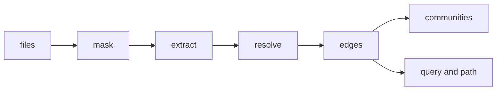
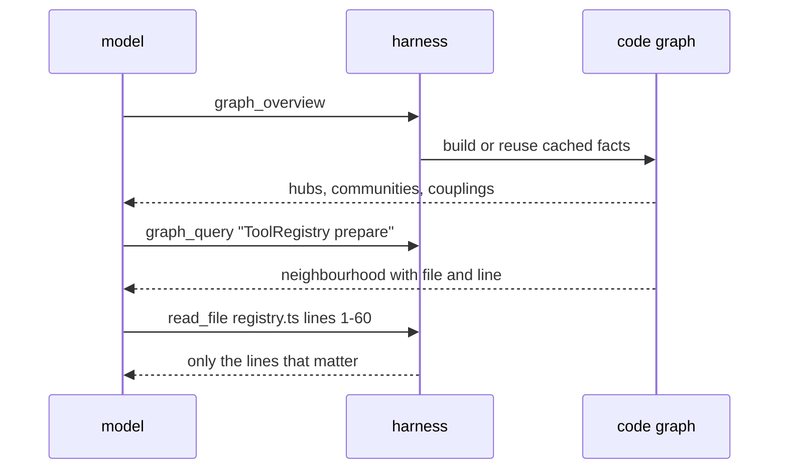

# how a coding agent sees a codebase as a graph

ask a coding agent where saved chats are restored and it usually does the same thing a new teammate would. it searches for a few words, opens a file, follows an import, opens another file, and slowly builds a map in its context window.

that map is expensive. every file it opens is paid for in tokens, and most of what it reads is not what it was looking for.

the harness i’m building has a different first move. before reading anything, the agent can ask a graph: what are the important pieces here, what touches this symbol, and how does one thing reach another? this post is about how that graph is built and queried, because most of the interesting decisions are small and a little unglamorous.

## what is in the graph

the graph has two kinds of things.

nodes are files, classes, interfaces, types, enums, functions, methods and top-level constants. each one carries a file and a line.

edges are relationships between them:

- `contains`: a file holds a symbol, or a class holds a method
- `imports`: one file imports another, including re-exports
- `calls`: a symbol calls another
- `uses`: a symbol mentions another without calling it
- `extends` and `implements`: inheritance

this is a structural graph. it knows who depends on whom. it does not know what the code means, and it makes no model calls to build itself.

## from text to facts

the first stage reads each source file as plain text and extracts facts about it. there is no external parser and nothing is executed.

that is a deliberate trade. a real parser per language is accurate but heavy, and it ties the harness to grammars and versions. a lexical extractor is small, has no dependencies, and handles typescript, javascript and python with one shared design. the cost is accuracy, which i come back to at the end.

the one trick that makes lexical extraction workable is masking. before looking for anything, comments are replaced with spaces, and so are the contents of strings. every character becomes a space except newlines, so offsets and line numbers stay exactly where they were.

without this, a comment that says `// TODO: call runAgent here` would create a call edge, and a string containing the word `class` would create a class. after masking, the extractor only sees code.

from the masked text, each file yields four lists: symbols, references (a name, whether it was called, and what it was called on), imports with their bindings, and inheritance clauses.



## turning names into edges

facts are just names. the builder has to decide which symbol each name refers to, and this is where most of the code lives.

imports come first. a specifier like `./registry.js` has to be mapped to a real file. in a typescript project that means trying `.ts`, `.tsx` and friends, handling the habit of writing `.js` in imports that point at `.ts` sources, and falling back to `index` files. python needs its own rules for relative dots and package `__init__.py` files.

then names are resolved in order:

1. a symbol defined in the same file
2. an imported binding, followed to its source file
3. if that file only re-exports the name, follow the re-export chain, up to three hops

member calls get more care. `this.prepare()` inside a class resolves to a method on that class, and if it isn’t there the lookup walks up the `extends` chain, up to four levels. a call through a namespace import, `tools.run()`, resolves against that module’s exports.

everything that resolves this way is stated in the source and has one possible answer. those edges are tagged `EXTRACTED`.

## when the graph is guessing

some calls cannot be resolved without types. `thing.prepare()` where the type of `thing` is unknown is the classic case. the builder does not drop these, but it does not trust them either.

if exactly one method with that name exists in the workspace, it adds an edge tagged `INFERRED` with a score: 0.7 if the file is the same or already imported, 0.4 otherwise. if several candidates exist but exactly one lives in a file that is imported or local, it adds that one at 0.6.

two filters keep this honest. names that are common everywhere (`map`, `get`, `push`, `then`, `parse` and a long tail of similar ones) never produce inferred edges, and neither do names shorter than four characters. an `INFERRED` edge to `get` would be noise.

the tag travels with the edge all the way to the model. when the agent reads a result it can see which links are in the source and which are a heuristic, and its instructions tell it to confirm the heuristic ones by opening the file.

## finding structure: communities

a repository has regions: the tool system, the ui, storage, the graph code itself. none of that is written down, but it shows in the edges. files in a region import and call each other far more than they touch the rest.

the graph recovers it with weighted label propagation. every file starts with its own label. then files are visited in a fixed order, and each one looks at its neighbours, adds up the weight behind each label, and switches to the heaviest label if it beats its current one.

weights depend on the relationship: `extends` counts 1.5, `imports`, `calls` and `implements` count 1, `uses` counts 0.5, and an inferred edge is scaled by its score. labels spread through tightly linked groups and stop at sparse boundaries. it usually settles in a few rounds, and it is capped at thirty.

try it on a toy graph of twelve files. the weights and update rule are the real ones.

```demo
label-propagation
```

two details matter in practice. a switch needs strictly more weight, so ties never cause oscillation. and label propagation can collapse a very tightly linked codebase into one giant blob, so any group holding more than 60 percent of the files (and more than twelve) is split by directory.

each community also gets a cohesion score, the share of its edge weight that stays inside it. a low score means a group that is mostly talking to other groups, which is itself worth knowing.

## asking the graph

the agent has three tools.

`graph_overview` is the first call in an unfamiliar repository. it lists the most connected symbols, the communities with their cohesion, and the cross-community links that are most likely to be surprising couplings.

`graph_query` takes a symbol or a short question. it scores every node against the words in the question and keeps the four best matches as seeds. an exact identifier match scores highest, then a name token, then a substring, then a mention in the file path. it then expands outward by breadth-first search, at most three hops, preferring extracted links over inferred ones and well-connected neighbours over leaves, with at most eight neighbours per node and a limit on how many nodes come back.

drag the sliders to see what that does.

```demo
query-expansion
```

`graph_path` finds the shortest chain of imports, calls or inheritance between two symbols, again by breadth-first search with an eight hop limit. it answers questions like how a user action reaches the filesystem layer.



every result is capped at 12,000 characters. the graph is a map. it tells the model where to look, and the model still reads the real code before it changes anything.

## keeping it cheap to build

the graph is rebuilt from the files on disk on every call, so it can never be stale. that only works because it is cheap.

- extraction results are cached per file, keyed by a sha1 of the content, so unchanged files are never re-extracted
- a scan stops at 2,000 files or 15 seconds, and says so when it was truncated
- results are cached for up to three workspaces

sub-agents are handled separately. each tool schema is sent with every request, so a tool a sub-agent doesn’t need still costs it tokens on every turn. sub-agents therefore get only `graph_query`, not all three tools.

## what it looked like on this repository

i ran it on the harness itself.

- 61 source files, 354 symbols, 1,223 relationships
- 1,172 of those relationships were extracted and 51 were inferred
- the first build took about 1.3 seconds, and a rebuild with warm caches about 60 milliseconds
- the source files in the graph come to roughly 97,000 tokens using the harness’s own estimator, while the overview was about 675 tokens and the queries i tried came back at roughly 900 to 1,150 tokens each

the overview found the real hubs without being told: the root `App` component, the `AgentTool` interface, `runAgent` and the sub-agent `investigate` function. it also split the code into the communities you would draw on a whiteboard, such as the agent loop, the tools, the renderer, and the graph code itself.

these numbers compare the size of what the graph returns with the size of the source. they are not a measurement of end-to-end savings. an agent still opens files after a query, and i have not yet benchmarked a full task with and without the graph. i would rather say that than guess.

## where it is wrong

the extractor is lexical, so it will be wrong in predictable ways.

- dynamic dispatch, callbacks passed around as values, and calls through an untyped object are missed or only inferred
- it supports typescript, javascript and python, and nothing else
- communities are a heuristic, so a boundary can land a file in the wrong group

the tags are the answer to most of this. a wrong inferred edge is labelled as a guess, with a score, next to a file and line the model can open. a missing edge is the bigger risk, because nothing marks it, which is why the instructions treat the graph as a starting point and send the agent to the source before any edit.

## what i would do next

a type-aware extractor for typescript would turn many inferred edges into extracted ones. the second is incremental rebuilds that patch the graph instead of recomputing it. the third, and the one i care most about, is the benchmark: the same questions with and without the graph, counting tokens, tool calls and whether the answer was right.
